# Historia de Orbital

Recorrido por las nueve versiones del panel, de la primera a la **v9.0**, la más reciente. Hasta la v9.0 se llamó **Panel del PC**; desde el 23 de noviembre de 2026 se llama **Orbital**. Las capturas se tomaron ejecutando cada versión tal como quedó, en el PC y a tamaño de celular.

> **Cómo se armó este historial.** Las versiones 1 a 5 se hicieron sin git. Su historial se reconstruyó el 21 de noviembre de 2026 a partir del registro de la sesión de Claude Code en la que se construyó.
> - Cada commit es el estado real de los archivos después de cada pedido, con su fecha y hora de Colombia.
> - La última versión coincide byte a byte con la carpeta original.
> - Antes del paquete para compartir no existía `config.ejemplo.json`. En esos commits es una copia de la configuración de ese momento, sin datos personales.
>
> Desde la v6.0, cada cambio se guarda en git en el momento en que se hace.

## Cómo abrir una versión anterior

Sin tocar la carpeta del panel, en una carpeta aparte:

```powershell
git worktree add ..\panel-v2 v2.0
cd ..\panel-v2
copy config.ejemplo.json config.json
$env:PANEL_PORT = 8790; node server.js
```

Abre en el navegador del PC la dirección que imprime (`http://localhost:8790/#t=…`) y activa la vista de celular con F12. Para borrar la carpeta al terminar, cierra el servidor y ejecuta `git worktree remove ..\panel-v2`.

---

## v1.0 · Versión inicial

**20 nov 2026, 8:59 a. m.** · Pedido: *«¿Podemos hacer un panel de control que sea ejecutado en el celular vía USB?»*

- Es un servidor en Node, sin dependencias, cuya página se abre en el Chrome del celular a través del cable, con el túnel `adb reverse`.
- Tiene tres pestañas, en vertical:
  - **Atajos:** multimedia, Explorador, Descargas, Calculadora, Recorte y Administrador de tareas.
  - **Monitor:** CPU, RAM y disco.
  - **Comandos:** se ejecutan en el PC y el resultado se ve en el celular.
- Son 6 archivos: `server.js`, `public/index.html`, `config.json`, `iniciar.ps1`, `iniciar.cmd` y `LEEME.md`.

<p>
  
  
  
</p>

## v2.0 · UI mejorado

**20 nov 2026, 9:08 a 9:25 a. m.** · Pedido: *tomar como referencia visual el proyecto PhoneBox.*

- **Nuevo diseño:**
  - fondo oscuro con tarjetas y reloj grande;
  - tarjeta de música con lo que suena en el PC: carátula, progreso y controles (`lib/media.ps1`);
  - gráficas de CPU, RAM, red y disco;
  - páginas que se deslizan, pensadas para el celular en horizontal.
- **Uso en el celular:**
  - el primer toque pone el panel a pantalla completa;
  - la pantalla no se apaga mientras está abierto;
  - se puede instalar como app con su propio icono.
- Fue la primera prueba en un celular real.

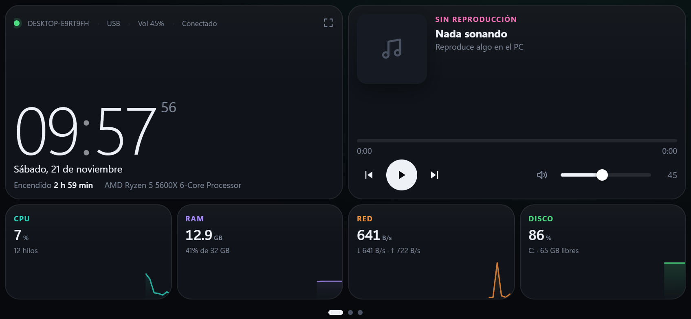

<p>
  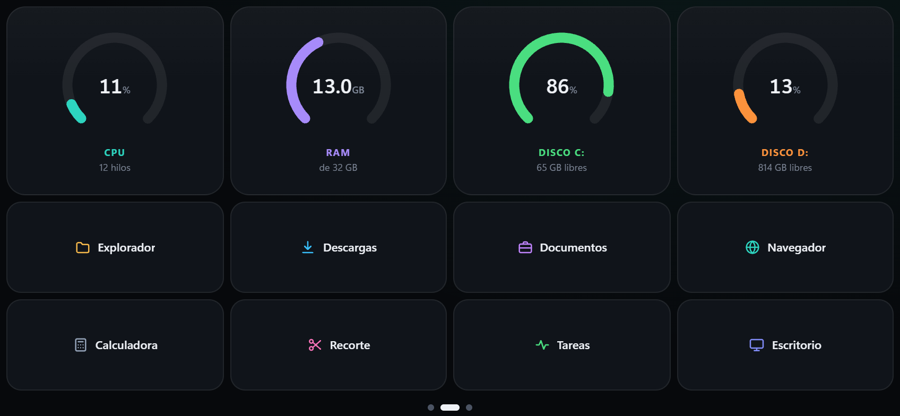
  
</p>

| Fecha | Cambio |
|---|---|
| 20/11 09:08 | Nuevo diseño con referencia visual de PhoneBox |
| 20/11 09:21 | Corrige la gráfica de red que tapaba el texto |
| 20/11 09:25 | Pantalla completa y modo app |

## v3.0 · Más pantallas y widgets

**20 nov 2026, 9:39 a 9:40 a. m.** · Pedido: *«Agrega más páginas como en PhoneBox».*

El panel pasa de 3 a 7 páginas:

- **Rendimiento:** historial de 3 minutos de CPU, RAM y red, y uso de cada núcleo.
- **Procesos:** los programas que más CPU y memoria usan, agrupados por programa.
- **Enfoque:** pomodoro y lista de tareas, que se guarda en el PC.
- **Calendario:** el mes, relojes del mundo y el clima de Medellín (Open-Meteo).

<p>
  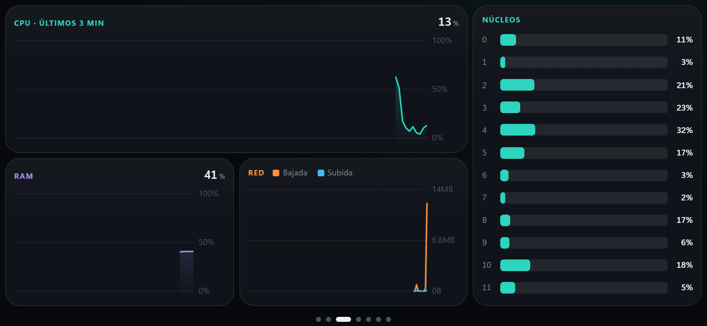
  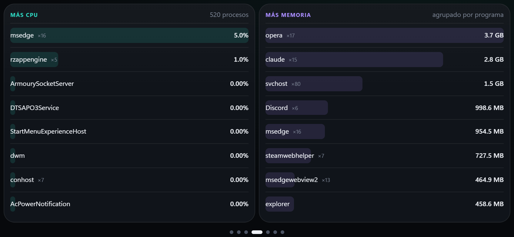
</p>
<p>
  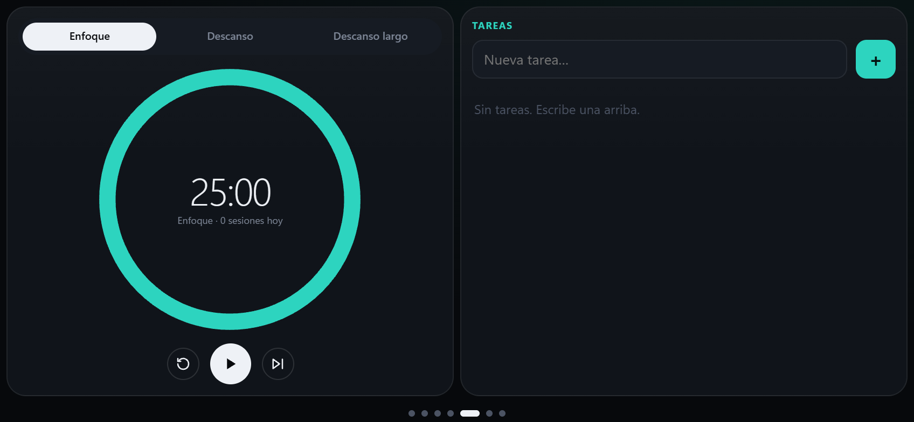
  
</p>

| Fecha | Cambio |
|---|---|
| 20/11 09:39 | Cuatro páginas nuevas: Rendimiento, Procesos, Enfoque y Calendario |
| 20/11 09:40 | Clima de Medellín en la página Calendario |

### Entre v3.0 y v4.0: Discord y accesos rápidos

- **Página Discord:** compartir pantalla, micrófono, ensordecer y modo streamer, con atajos globales.
- **Atajos con SendInput y scan codes:** Discord ignoraba los de SendKeys cuando estaba en primer plano.
- **Cable USB:** el túnel se recupera solo al reconectar el cable, y el panel espera a que el celular autorice la depuración USB.
- **Botones de acceso rápido en Enfoque:** Cursos IxDF y Claude Academy.

<p>
  
  
</p>

| Fecha | Cambio |
|---|---|
| 20/11 09:44 | Icono del panel para el acceso directo del menú Inicio |
| 20/11 09:49 | Página de Discord: micrófono, ensordecer y modo streamer |
| 20/11 23:17 | El túnel USB se recupera solo |
| 20/11 23:22 | Botón para compartir pantalla en Discord |
| 20/11 23:29 | Los atajos de teclado usan SendInput con scan codes |
| 20/11 23:33 | Botones de acceso rápido en la página Enfoque |
| 20/11 23:35 | Botón de Claude Academy en Enfoque |
| 20/11 23:40 | Espera hasta 60 s a que el celular autorice la depuración USB |
| 20/11 23:44 | Guía: qué hacer si el panel no abre en el celular |

## v4.0 · Wi-Fi, con el USB como puente

**20 nov 2026, 11:48 p. m. a 21 nov, 12:10 a. m.** · Pedido: *«¿Podemos hacer que esta conexión ocurra vía wifi?»*

- **Modo Wi-Fi:** el servidor también escucha en la IP local del PC, y el modo se abre con el icono **Panel Wi-Fi** (`iniciar-wifi.cmd`).
- **El cable como puente:** el celular se conecta por cable una vez para que el PC conozca su IP y lo autorice. Por eso todavía hace falta el modo desarrollador con la depuración USB.
- **Solo entran los dispositivos autorizados** (`wifi.dispositivos`). A cualquier otro equipo de la red se le corta la conexión sin responderle.
- **Tiempo límite en las peticiones:** una pestaña congelada por Chrome dejaba los comandos colgados.
- **La interfaz es la misma de antes.** Lo que cambia es la conexión: la barra de arriba dice *Wi-Fi*.

| Fecha | Cambio |
|---|---|
| 20/11 23:48 | Modo Wi-Fi: el panel también escucha en la red local |
| 20/11 23:55 | Registro de depuración y tiempo límite al leer peticiones |
| 21/11 00:00 | Tiempo límite en las peticiones del celular |
| 21/11 00:10 | Wi-Fi: solo entran los dispositivos autorizados |

### Entre v4.0 y v5.0: compartirlo

- **Paquete .zip con instalador** (`empaquetar.ps1`, `instalar.cmd`), sin datos personales.
- **`verificar.cmd`:** revisa Node.js, los componentes de Windows, el puerto, la red, el firewall y adb, y ofrece instalar lo que falte.

| Fecha | Cambio |
|---|---|
| 21/11 00:22 | Paquete para compartir: .zip con instalador |
| 21/11 00:36 | Verificación de requisitos e instalación de lo que falte |

## v5.0 · Solo Wi-Fi

**21 nov 2026, 7:52 a 8:02 a. m.** · Pedido: *«Sí, hazlo con el QR y la aprobación»* y *«Dejar en el .zip solo la versión wifi»*.

- **El PC muestra un código QR.** Lo genera el propio PC con `lib/qr.js`, sin internet, y lleva la dirección y el token.
- **El celular escanea el QR** y abre una página de espera.
- **En el PC aparece el aviso «¿Permitir este dispositivo?»,** con la IP y el modelo del celular. Si se acepta, su IP queda guardada y el panel se abre solo.
- **Ya no hace falta el cable ni el modo desarrollador.**
- **`Panel-WiFi.zip`:** es la edición para compartir. Trae un solo icono, no usa adb y tiene su propia guía. La edición completa (USB y Wi-Fi) se sigue generando con `.\empaquetar.ps1 -Edicion Completa`.

<p>
  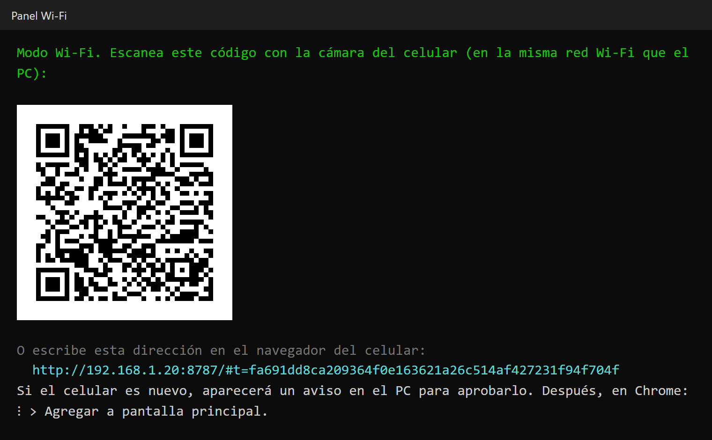
  
</p>

*La captura del QR usa una IP y un token de ejemplo.*

| Fecha | Cambio |
|---|---|
| 21/11 07:52 | Wi-Fi sin modo desarrollador: código QR y aprobación en el PC |
| 21/11 08:02 | Edición solo Wi-Fi para compartir |

## v6.0 · Ventana propia, sin consola

**21 nov 2026** · Pedido: *«¿Podemos crearle una interfaz visual para evitar que se vea esa pantalla de cmd?»*

- **Ya no aparece la consola.** Los iconos del menú Inicio abren una ventana con el mismo diseño oscuro del panel:
  - el estado del panel;
  - en Wi-Fi, el código QR y la dirección, con un botón para copiarla;
  - por cable, si el celular está conectado;
  - los dispositivos autorizados, cada uno con un botón **Quitar**;
  - la actividad: los botones pulsados desde el celular y los dispositivos que piden entrar.
- **Selector Wi-Fi / Cable USB** para cambiar de modo sin cerrar nada. La edición solo Wi-Fi no lo muestra.
- **Cerrar la ventana no detiene el panel:** queda un icono junto al reloj. Para detenerlo, se pulsa **Detener el panel**.
- **Una sola copia a la vez:** si se vuelve a pulsar el icono, se muestra la ventana que ya estaba abierta. Si hay una consola de una versión anterior en el mismo puerto, la ventana ofrece cerrarla.
- **El servidor se cierra solo** si la ventana desaparece de golpe; así no quedan procesos sueltos.
- **`Panel del PC.exe`:** lo crea `instalar.cmd` en cada PC con el compilador de C# que trae Windows, así que no se descarga nada. Ejecuta `ventana.ps1` dentro de su propio proceso, y por eso aparece en la barra de tareas con su nombre y su icono. Si no se puede crear, la ventana se abre con PowerShell oculto.
- **El modo consola sigue existiendo** (`iniciar.ps1`) para diagnosticar. La lógica de arranque que comparten la consola y la ventana pasó a `lib/arranque.ps1`.

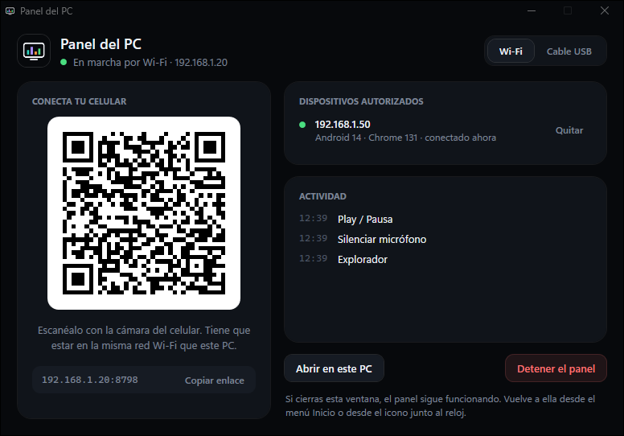

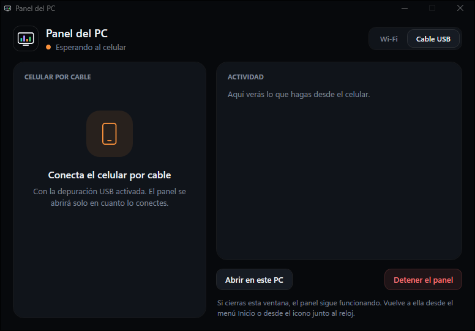

*Las capturas usan una IP, un celular y una actividad de ejemplo.*

## v7.0 · Mezclador y páginas a tu medida

**23 nov 2026** · Pedidos: *«Revisa porque los botones de pasar canciones no funcionan»*, *«¿Podemos hacer una pantalla con el mezclador de sonidos de windows?»*, *«Agrega cambiar la salida de audio en el mezclador»* y *«Vamos a crear una pantalla para controlar las pantallas que van a verse y en qué orden se van a mostrar, después de conectar el celular»*.

- **Página Mezclador**, la segunda del celular: funciona como el mezclador de volumen de Windows.
  - Hay una columna por cada aplicación que usa el sonido del PC, con su icono, un control vertical, el botón de silencio y un medidor que se mueve con el sonido.
  - La primera columna es el volumen general.
  - La página solo le pregunta al PC mientras está a la vista.
- **Cambiar la salida de audio:** arriba del mezclador se ve la salida actual. Al tocarla se elige otra (altavoces, audífonos, monitor…), como en el icono del volumen de Windows. Las llamadas también se cambian, salvo que en Windows estén a propósito en otra salida.
- **Páginas del celular:** un botón nuevo en la ventana del PC para elegir qué páginas se ven en el celular y en qué orden.
  - Cada cambio llega al celular al momento, sin recargar.
  - La primera página es la que aparece al conectarlo.
  - El orden se guarda en `data/paginas.json`.
- **Los botones de pasar canciones ya funcionan con cualquier teclado.** Antes enviaban un carácter que, con el teclado latinoamericano, se escribía como «°». Ahora usan los controles de música de Windows y, si no hay ninguno, la tecla multimedia de verdad.

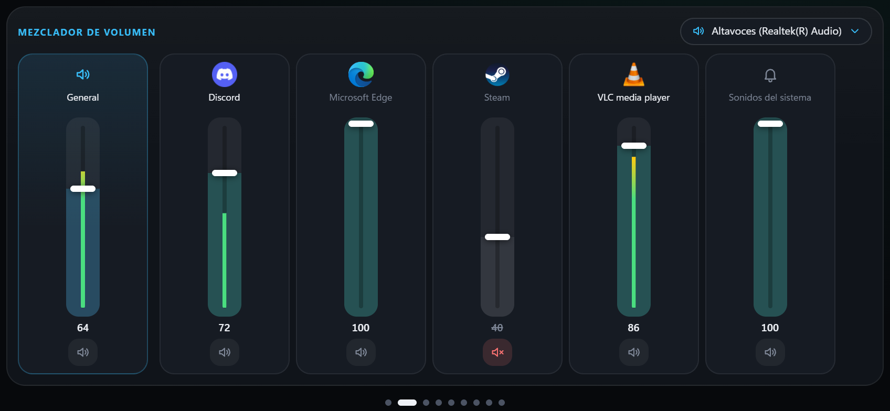

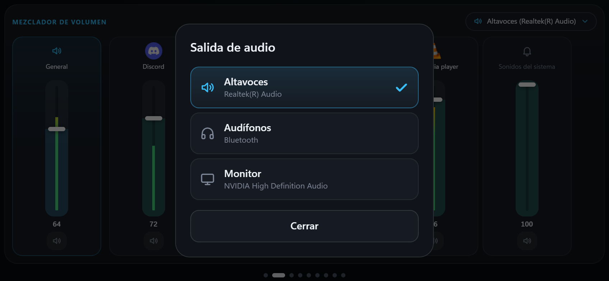

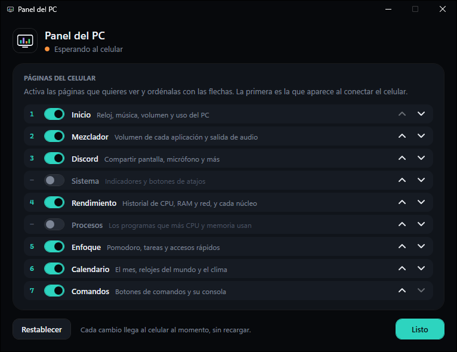

*Las capturas del mezclador usan aplicaciones y salidas de audio de ejemplo.*

| Fecha | Cambio |
|---|---|
| 23/11 07:24 | Los botones de pasar canciones funcionan con cualquier teclado |
| 23/11 08:10 | Página Mezclador: el volumen de cada aplicación, como en Windows |
| 23/11 10:08 | Mezclador: cambiar la salida de audio desde el celular |
| 23/11 10:51 | Elegir en el PC qué páginas ve el celular y en qué orden |

## v8.0 · Solo Wi-Fi, en español o inglés

**23 nov 2026** · Pedidos: *«Tomemos de referencia este para rediseñar la selección de pantallas»*, *«Vamos a cambiarle el redondeado de los bordes de "Al conectar" y de los números para que coincidan con los de los marcos»* y *«Vamos a cambiar el toggle para la selección de modo y lo ponemos solo para selección de idioma, ya quitemos la opción de usb»*.

Se marcó como la versión final; el mismo día llegó la v9.0.

- **Solo Wi-Fi.** Se quitó el modo por cable USB: el celular entra siempre por la red de la casa, con el código QR y la aprobación en el PC.
  - Ya no hacen falta adb ni el modo desarrollador del celular.
  - Queda un solo icono, **Panel del PC**; `instalar.cmd` quita los viejos «Panel USB» y «Panel Wi-Fi». Los iconos y el `Panel del PC.exe` de versiones anteriores siguen funcionando.
  - Hay un solo .zip para compartir (`Panel-del-PC.zip`) y una sola guía (`LEEME.md`).
- **Español o inglés.** El selector del encabezado de la ventana, que elegía Wi-Fi o cable, ahora elige el idioma.
  - Cambia a la vez la ventana, la página del celular (al momento, sin recargar), la página de espera y el aviso para aprobar celulares nuevos.
  - Se guarda en `data/preferencias.json`; la primera vez se usa el idioma de Windows.
- **Páginas del celular, rediseñadas** con una galería de diseños como referencia: una cuadrícula de tarjetas con la vista previa de cada página.
  - El interruptor de cada tarjeta la muestra u oculta. Para ordenarlas, se arrastra una tarjeta sobre otra, o se usan las flechas que aparecen encima.
  - «Al conectar» marca la primera; las ocultas se ven tenues, con «Oculta».
  - Las vistas previas usan datos de ejemplo y están en los dos idiomas; las genera `herramientas/miniaturas.js`.
  - Las etiquetas y los números tienen esquinas redondeadas que siguen las de los marcos.

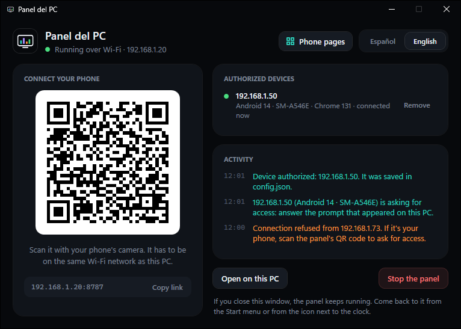

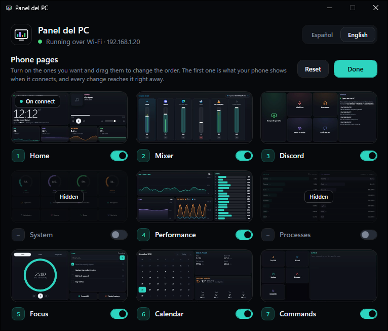

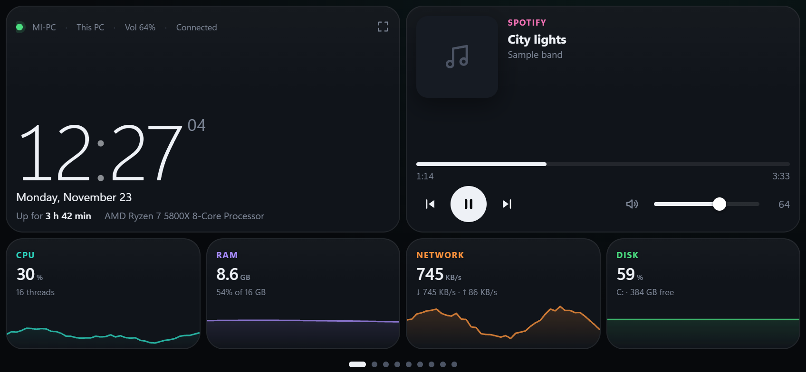

*Las capturas usan una IP, un celular, una actividad y datos de ejemplo.*

| Fecha | Cambio |
|---|---|
| 23/11 11:29 | Páginas del celular: tarjetas con vista previa y arrastrar para ordenar |
| 23/11 11:36 | Páginas del celular: etiquetas y números con esquinas como las de los marcos |
| 23/11 12:23 | Solo Wi-Fi y selector de idioma (español o inglés) |

## v9.0 · Un solo programa, agenda y atajos editables

**23 nov 2026** · Pedidos: *«Vamos a generar un ejecutable que pueda compartir para así poder probarlo en otros dispositivos»*, *«¿Por qué en algunos dispositivos no se dejaría visualizar el apartado web?»*, *«Podemos revisar si puede tomar la ubicación para que la ventana de calendario pueda tener el clima, además podemos hacer que el calendario sea interactivo»*, *«Cambiemos el nombre a Páginas del celular, a selección de widgets»* y *«¿Podemos hacer que los atajos del sistema sean editables desde el PC?»*.

- **Un solo programa para compartir.** `herramientas/portatil.ps1` genera `Panel del PC.exe`, con todo el panel y Node.js dentro.
  - En otro PC basta con hacerle doble clic: se prepara en `%LOCALAPPDATA%\Panel del PC` y deja el icono en el menú Inicio.
  - Un `.exe` más nuevo actualiza el programa y conserva la configuración, el token y los datos.
- **Aviso del firewall de Windows.** Desde el propio PC no se nota si el firewall no deja entrar al celular, así que la ventana lo revisa aparte.
  - Si está bloqueado, el estado pasa a naranja y el aviso ofrece **Permitir el acceso**, con el permiso de administrador de Windows.
  - El aviso se quita solo en cuanto se arregla. `verificar.cmd` e `instalar.cmd` también lo revisan.
- **Calendario con agenda y clima.**
  - El clima usa la ubicación de Windows del PC, con el botón **Mostrar el clima de aquí**.
  - La agenda se lee desde el enlace privado iCal de Google Calendar (u otro). Los días con algo agendado llevan un punto, y al tocar uno se abre su agenda.
  - En la de hoy, lo que ya pasó se ve tenue y la lista empieza en lo siguiente.
- **Selección de widgets.** Así se llama ahora lo que antes era «Páginas del celular».
- **Atajos editables desde el PC.** Con el botón **Atajos** de la ventana se agregan, editan, quitan y ordenan los botones de la página Sistema.
  - Cada botón tiene nombre, color e icono, y abre algo, envía un atajo de teclado o ejecuta un comando.
  - El celular ve cada cambio al momento, sin recargar.

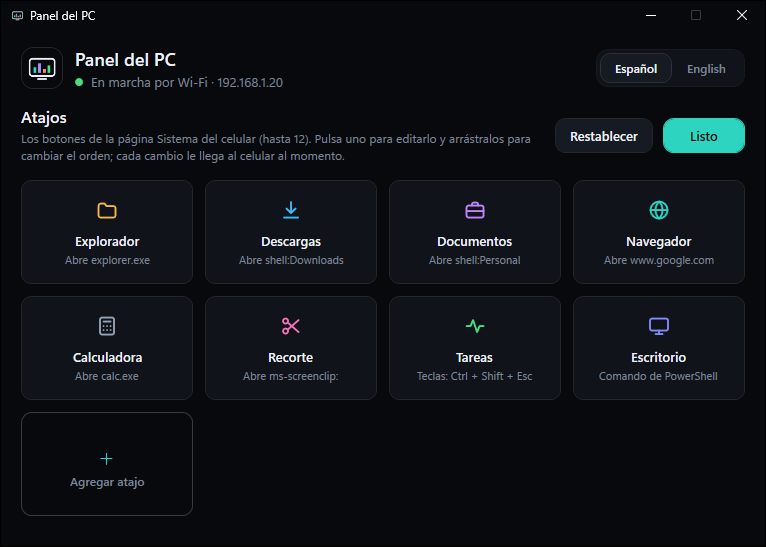

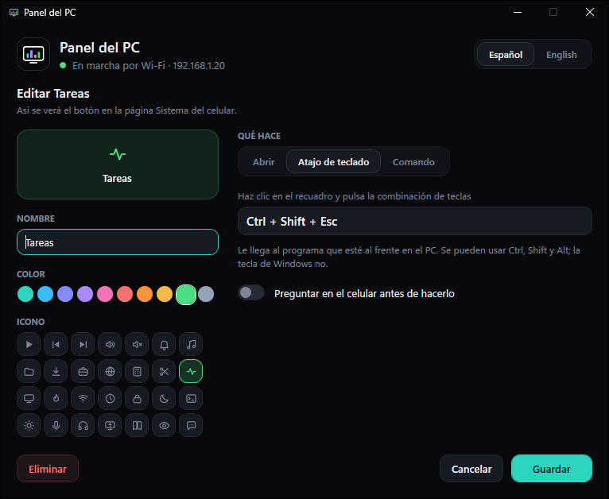

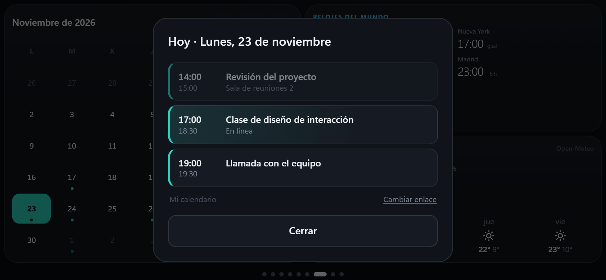

*Las capturas usan una IP, una agenda, un clima y datos de ejemplo.*

| Fecha | Cambio |
|---|---|
| 23/11 14:23 | Ejecutable para compartir y aviso del firewall de Windows |
| 23/11 14:47 | Calendario: clima con la ubicación del PC y agenda del día |
| 23/11 14:52 | «Páginas del celular» pasa a llamarse «Selección de widgets» |
| 23/11 16:57 | Editar los atajos de la página Sistema desde la ventana del PC |
