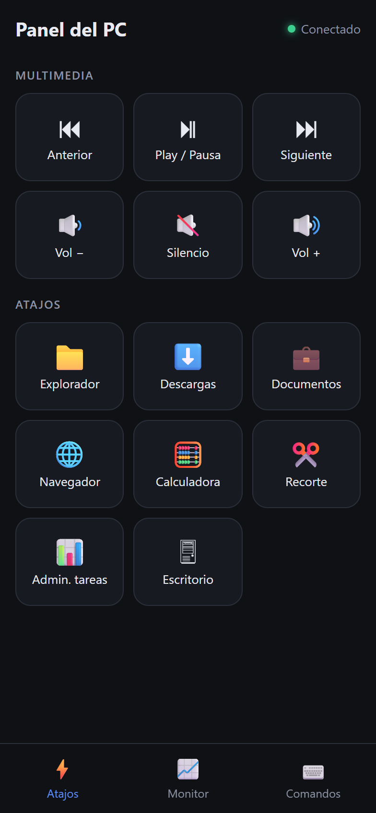
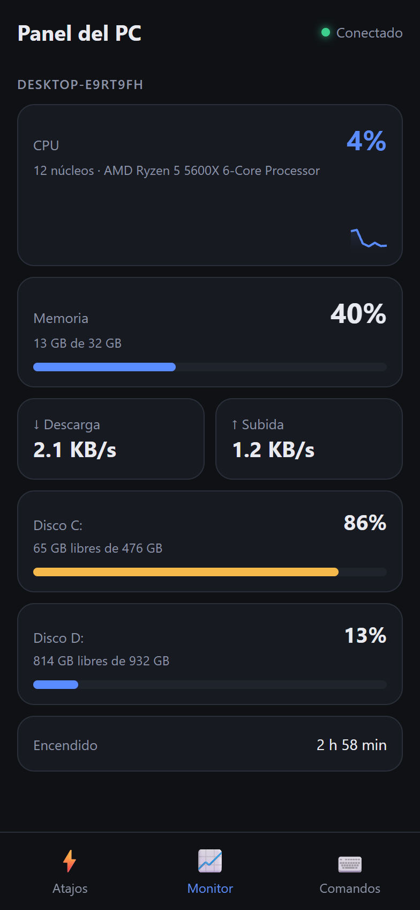
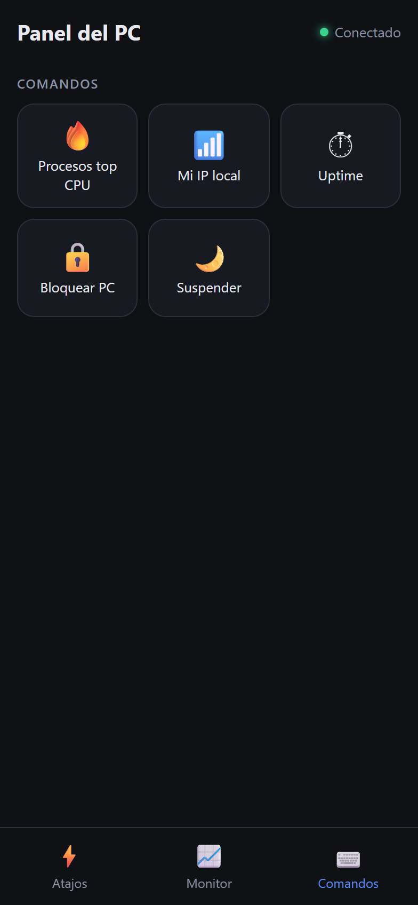
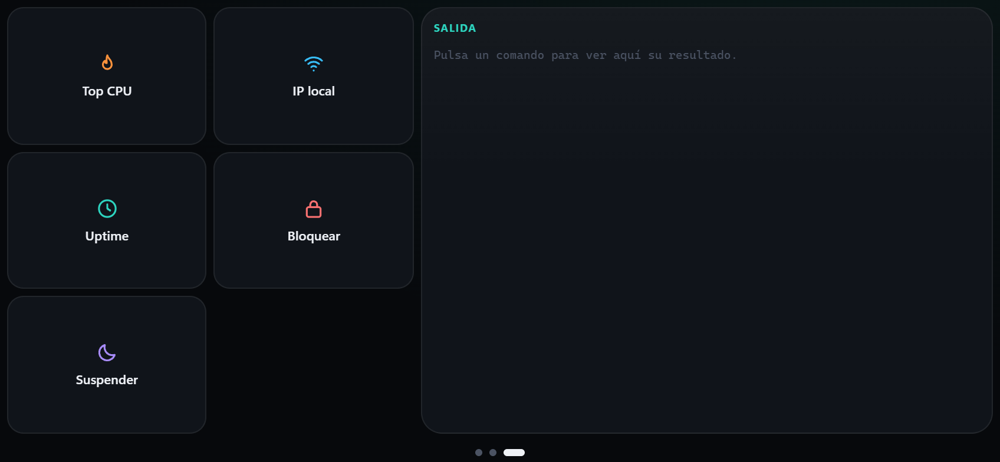
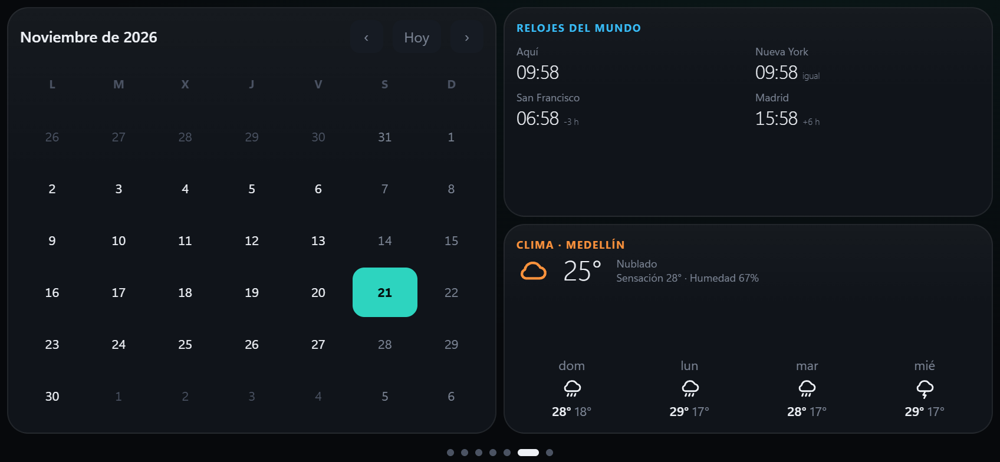
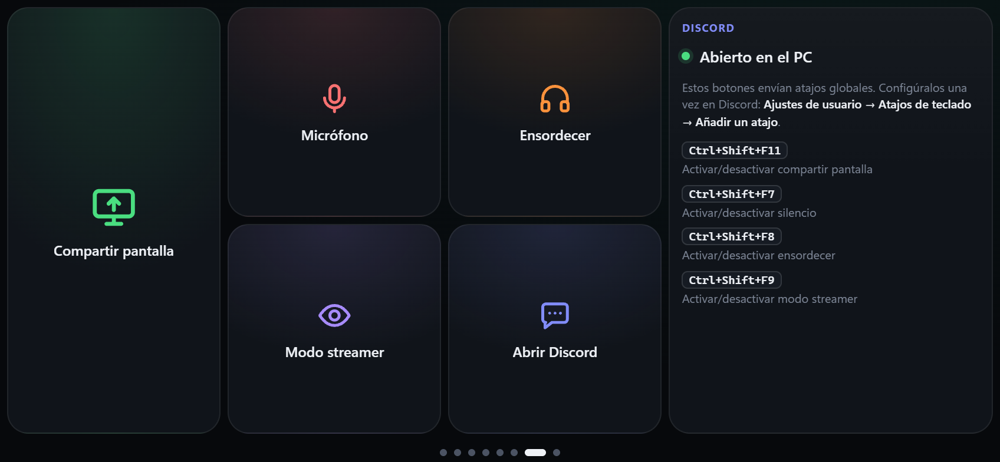
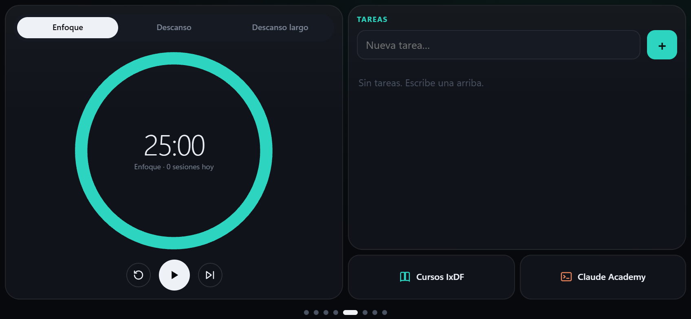
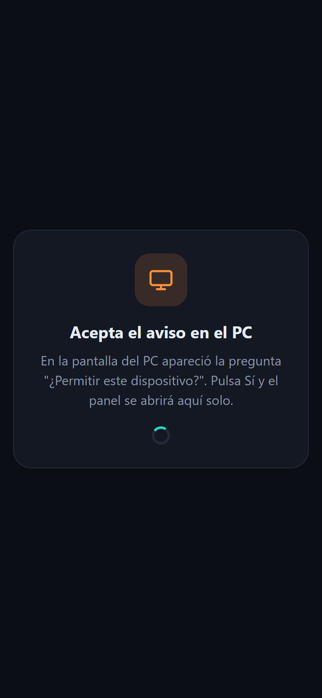

# Historia del Panel del PC

Recorrido por las cinco versiones del panel. Las capturas se tomaron ejecutando cada versión tal como quedó, en el PC y a tamaño de celular.

> **Cómo se armó este historial.** El proyecto se hizo sin git. Este historial se reconstruyó el 21 de noviembre de 2026 a partir del registro de la sesión de Claude Code en la que se construyó.
> - Cada commit es el estado real de los archivos después de cada pedido, con su fecha y hora de Colombia.
> - La última versión coincide byte a byte con la carpeta original.
> - Antes del paquete para compartir no existía `config.ejemplo.json`. En esos commits es una copia de la configuración de ese momento, sin datos personales.

## Cómo abrir una versión anterior

Sin tocar la carpeta del panel, en una carpeta aparte:

```powershell
git worktree add ..\panel-v2 v2.0
cd ..\panel-v2
copy config.ejemplo.json config.json
$env:PANEL_PORT = 8790; node server.js
```

Abre en el navegador del PC la dirección que imprime (`http://localhost:8790/#t=…`) y activa la vista de celular con F12. Para borrar la carpeta al terminar, cierra el servidor y ejecuta `git worktree remove ..\panel-v2`.

---

## v1.0 · Versión inicial

**20 nov 2026, 8:59 a. m.** · Pedido: *«¿Podemos hacer un panel de control que sea ejecutado en el celular vía USB?»*

- Es un servidor en Node, sin dependencias, cuya página se abre en el Chrome del celular a través del cable, con el túnel `adb reverse`.
- Tiene tres pestañas, en vertical:
  - **Atajos:** multimedia, Explorador, Descargas, Calculadora, Recorte y Administrador de tareas.
  - **Monitor:** CPU, RAM y disco.
  - **Comandos:** se ejecutan en el PC y el resultado se ve en el celular.
- Son 6 archivos: `server.js`, `public/index.html`, `config.json`, `iniciar.ps1`, `iniciar.cmd` y `LEEME.md`.

<p>
  
  
  
</p>

## v2.0 · UI mejorado

**20 nov 2026, 9:08 a 9:25 a. m.** · Pedido: *tomar como referencia visual el proyecto PhoneBox.*

- **Nuevo diseño:**
  - fondo oscuro con tarjetas y reloj grande;
  - tarjeta de música con lo que suena en el PC: carátula, progreso y controles (`lib/media.ps1`);
  - gráficas de CPU, RAM, red y disco;
  - páginas que se deslizan, pensadas para el celular en horizontal.
- **Uso en el celular:**
  - el primer toque pone el panel a pantalla completa;
  - la pantalla no se apaga mientras está abierto;
  - se puede instalar como app con su propio icono.
- Fue la primera prueba en un celular real.


<p>
  
  
</p>

| Fecha | Cambio |
|---|---|
| 20/11 09:08 | Nuevo diseño con referencia visual de PhoneBox |
| 20/11 09:21 | Corrige la gráfica de red que tapaba el texto |
| 20/11 09:25 | Pantalla completa y modo app |

## v3.0 · Más pantallas y widgets

**20 nov 2026, 9:39 a 9:40 a. m.** · Pedido: *«Agrega más páginas como en PhoneBox».*

El panel pasa de 3 a 7 páginas:

- **Rendimiento:** historial de 3 minutos de CPU, RAM y red, y uso de cada núcleo.
- **Procesos:** los programas que más CPU y memoria usan, agrupados por programa.
- **Enfoque:** pomodoro y lista de tareas, que se guarda en el PC.
- **Calendario:** el mes, relojes del mundo y el clima de Medellín (Open-Meteo).

<p>
  
  
</p>
<p>
  
  
</p>

| Fecha | Cambio |
|---|---|
| 20/11 09:39 | Cuatro páginas nuevas: Rendimiento, Procesos, Enfoque y Calendario |
| 20/11 09:40 | Clima de Medellín en la página Calendario |

### Entre v3.0 y v4.0: Discord y accesos rápidos

- **Página Discord:** compartir pantalla, micrófono, ensordecer y modo streamer, con atajos globales.
- **Atajos con SendInput y scan codes:** Discord ignoraba los de SendKeys cuando estaba en primer plano.
- **Cable USB:** el túnel se recupera solo al reconectar el cable, y el panel espera a que el celular autorice la depuración USB.
- **Botones de acceso rápido en Enfoque:** Cursos IxDF y Claude Academy.

<p>
  
  
</p>

| Fecha | Cambio |
|---|---|
| 20/11 09:44 | Icono del panel para el acceso directo del menú Inicio |
| 20/11 09:49 | Página de Discord: micrófono, ensordecer y modo streamer |
| 20/11 23:17 | El túnel USB se recupera solo |
| 20/11 23:22 | Botón para compartir pantalla en Discord |
| 20/11 23:29 | Los atajos de teclado usan SendInput con scan codes |
| 20/11 23:33 | Botones de acceso rápido en la página Enfoque |
| 20/11 23:35 | Botón de Claude Academy en Enfoque |
| 20/11 23:40 | Espera hasta 60 s a que el celular autorice la depuración USB |
| 20/11 23:44 | Guía: qué hacer si el panel no abre en el celular |

## v4.0 · Wi-Fi, con el USB como puente

**20 nov 2026, 11:48 p. m. a 21 nov, 12:10 a. m.** · Pedido: *«¿Podemos hacer que esta conexión ocurra vía wifi?»*

- **Modo Wi-Fi:** el servidor también escucha en la IP local del PC, y el modo se abre con el icono **Panel Wi-Fi** (`iniciar-wifi.cmd`).
- **El cable como puente:** el celular se conecta por cable una vez para que el PC conozca su IP y lo autorice. Por eso todavía hace falta el modo desarrollador con la depuración USB.
- **Solo entran los dispositivos autorizados** (`wifi.dispositivos`). A cualquier otro equipo de la red se le corta la conexión sin responderle.
- **Tiempo límite en las peticiones:** una pestaña congelada por Chrome dejaba los comandos colgados.
- **La interfaz es la misma de antes.** Lo que cambia es la conexión: la barra de arriba dice *Wi-Fi*.

| Fecha | Cambio |
|---|---|
| 20/11 23:48 | Modo Wi-Fi: el panel también escucha en la red local |
| 20/11 23:55 | Registro de depuración y tiempo límite al leer peticiones |
| 21/11 00:00 | Tiempo límite en las peticiones del celular |
| 21/11 00:10 | Wi-Fi: solo entran los dispositivos autorizados |

### Entre v4.0 y v5.0: compartirlo

- **Paquete .zip con instalador** (`empaquetar.ps1`, `instalar.cmd`), sin datos personales.
- **`verificar.cmd`:** revisa Node.js, los componentes de Windows, el puerto, la red, el firewall y adb, y ofrece instalar lo que falte.

| Fecha | Cambio |
|---|---|
| 21/11 00:22 | Paquete para compartir: .zip con instalador |
| 21/11 00:36 | Verificación de requisitos e instalación de lo que falte |

## v5.0 · Solo Wi-Fi

**21 nov 2026, 7:52 a 8:02 a. m.** · Pedido: *«Sí, hazlo con el QR y la aprobación»* y *«Dejar en el .zip solo la versión wifi»*.

- **El PC muestra un código QR.** Lo genera el propio PC con `lib/qr.js`, sin internet, y lleva la dirección y el token.
- **El celular escanea el QR** y abre una página de espera.
- **En el PC aparece el aviso «¿Permitir este dispositivo?»,** con la IP y el modelo del celular. Si se acepta, su IP queda guardada y el panel se abre solo.
- **Ya no hace falta el cable ni el modo desarrollador.**
- **`Panel-WiFi.zip`:** es la edición para compartir. Trae un solo icono, no usa adb y tiene su propia guía. La edición completa (USB y Wi-Fi) se sigue generando con `.\empaquetar.ps1 -Edicion Completa`.

<p>
  
  
</p>

*La captura del QR usa una IP y un token de ejemplo.*

| Fecha | Cambio |
|---|---|
| 21/11 07:52 | Wi-Fi sin modo desarrollador: código QR y aprobación en el PC |
| 21/11 08:02 | Edición solo Wi-Fi para compartir |
