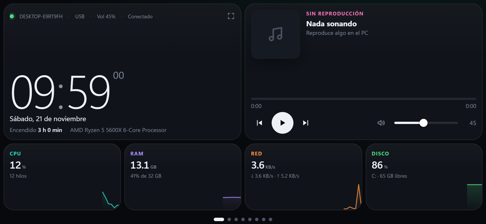

# Orbital

**Orbital** es un panel de control del PC que se abre en el navegador del celular (hasta la v9.0 se llamaba **Panel del PC**). Incluye:

- música y volumen, y un mezclador con el volumen de cada aplicación y la salida de audio;
- CPU, RAM, red y disco, con su historial y los procesos que más consumen;
- pomodoro y lista de tareas;
- calendario con tu agenda de Google Calendar (u otro con enlace iCal), relojes del mundo y el clima de donde está el PC;
- controles de Discord;
- botones de atajos y de comandos.

Desde la ventana del panel en el PC eliges qué páginas se ven en el celular y en qué orden, y el idioma: español o inglés.

Se conecta por la red Wi-Fi de la casa, escaneando un código QR y aprobando el celular en el PC. No hay que instalar nada en el celular, y en el PC solo necesita Node.js y PowerShell, sin otras dependencias.

## Usarlo

- **Guía:** [LEEME.md](LEEME.md) (es la misma que va en el .zip para compartir).
- **En corto:** doble clic en `instalar.cmd`, que revisa los requisitos y crea la ventana del panel y su icono. Luego abre **Orbital**, escanea el QR con el celular y acepta el aviso en el PC.
- **Para compartirlo como un solo programa:** `.\herramientas\portatil.ps1` crea `Orbital.exe`, con Node.js dentro: en el otro PC basta con hacerle doble clic.

## Versiones

| Etiqueta | Fecha | Qué trae |
|---|---|---|
| `v1.0` | 20 nov 2026 | Versión inicial: unos cuantos botones (atajos, monitor y comandos) por cable USB |
| `v2.0` | 20 nov 2026 | UI mejorado: diseño oscuro con tarjetas, música, páginas deslizables, pantalla completa y modo app |
| `v3.0` | 20 nov 2026 | Más pantallas y widgets: Rendimiento, Procesos, Enfoque y Calendario con clima |
| `v4.0` | 21 nov 2026 | Wi-Fi, con el cable USB como puente para autorizar el celular |
| `v5.0` | 21 nov 2026 | Solo Wi-Fi: código QR y aprobación en el PC, sin modo desarrollador; .zip para compartir |
| `v6.0` | 21 nov 2026 | Ventana propia en el PC, sin consola: QR, dispositivos, actividad, cambio de modo e icono junto al reloj |
| `v7.0` | 23 nov 2026 | Mezclador de volumen con cambio de salida de audio, y elegir en el PC qué páginas ve el celular y en qué orden |
| `v8.0` | 23 nov 2026 | Solo Wi-Fi, en español o inglés, y páginas del celular en tarjetas con vista previa |
| `v9.0` | 23 nov 2026 | Un solo programa para compartir, aviso del firewall, agenda y clima en el Calendario, y atajos editables desde el PC |

La **v9.0** es la versión más reciente del panel.

El recorrido por cada versión, con capturas y todos los cambios, está en **[HISTORIA.md](HISTORIA.md)**.

## Estructura

| Archivo | Para qué |
|---|---|
| `server.js` | Servidor HTTP en Node, sin dependencias |
| `public/` | La página del celular (`index.html`), la de espera de aprobación (`espera.html`) y el manifest de la app; cada una trae su traducción al inglés |
| `public/miniaturas/` | Vistas previas de las páginas, para elegirlas en la ventana (con datos de ejemplo; en `en/`, en inglés) |
| `lib/media.ps1` | Música que suena en el PC, controles de música y volumen |
| `lib/mezclador.ps1` | Mezclador: volumen, silencio y nivel de sonido de cada aplicación, y salida de audio |
| `lib/keys.ps1` | Atajos de teclado (SendInput con scan codes) |
| `lib/qr.js` | Generador de códigos QR, hecho desde cero |
| `lib/aprobacion.js`, `lib/allow.js` | Aprobación de dispositivos nuevos y lista de dispositivos permitidos |
| `lib/agenda.js` | Lee el calendario desde su enlace iCal (.ics), con repeticiones y zonas horarias, para la agenda de la página Calendario |
| `lib/requisitos.ps1` | Revisión de requisitos (la usan `verificar`, `instalar`, `iniciar` y la ventana) |
| `ventana.ps1` | La ventana del panel en el PC: QR, estado, dispositivos, actividad, páginas del celular, idioma e icono junto al reloj |
| `lib/lanzador.cs` | `Orbital.exe`, que abre la ventana sin consola (lo compila `instalar` en cada PC) |
| `lib/portatil.cs` | La parte del ejecutable portátil que deja el panel listo en `%LOCALAPPDATA%\Panel del PC` y crea el icono |
| `lib/arranque.ps1` | Arranque compartido por la ventana y el modo consola: token, red y servidor |
| `iniciar.cmd` | Abre la ventana del panel |
| `iniciar.ps1` | Modo consola, con los mensajes del servidor a la vista |
| `instalar.*`, `verificar.*`, `empaquetar.ps1` | Instalación, verificación de requisitos y .zip para compartir |
| `herramientas/miniaturas.js` | Vuelve a generar `public/miniaturas/` con datos de ejemplo (Node 22+ y Edge); no va en el .zip |
| `herramientas/portatil.ps1` | Genera el ejecutable portátil: un solo `Orbital.exe` con todo el panel y Node.js, para compartir |

## Datos personales

`.token`, `config.json`, `data/` (tareas, orden de las páginas e idioma) y `debug.log` son de cada PC y están en `.gitignore`, así que nunca se suben.
La configuración de ejemplo es `config.ejemplo.json`; la primera vez, el servidor crea `config.json` a partir de ella.
